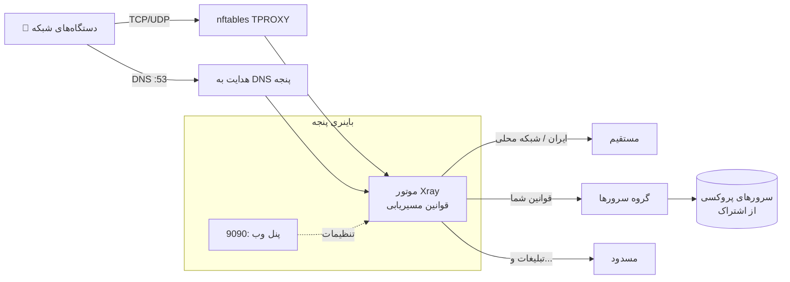

<div align="center">


# پنجه · Panje

**یک کلاینت ساده و سریع Xray (V2Ray) برای OpenWrt — شبیه Passwall ولی سبک.**
یک فایل اجرایی · موتور Xray داخلش است · پنل وب موبایل‌پسند · قوانین مسیریابی هوشمند

[](https://github.com/NimaParsayi/PanjeOpenWRT/releases)
[](https://github.com/NimaParsayi/PanjeOpenWRT/actions)
[](LICENSE)

[English](README.md) · **فارسی**

 &nbsp; 

</div>

<div dir="rtl" align="right">

> **وضعیت: نسخه اولیه.** امکانات اصلی کار می‌کنند ولی پروژه جوان است و تست میدانی محدودی داشته.
> اگر روی روترتان مشکلی دیدید [یک Issue باز کنید](https://github.com/NimaParsayi/PanjeOpenWRT/issues).

## چرا پنجه؟

| | |
|---|---|
| 🧩 **یک فایل** | یک باینری ایستا حدود ۳۰ مگابایت. **موتور Xray-core داخلش است** و بسته‌ی جداگانه‌ای لازم نیست. |
| 🇮🇷 **آگاه از ایران** | سایت‌ها و IPهای ایرانی به‌صورت پیش‌فرض **مستقیم** می‌روند و بقیه از پروکسی. |
| 🎯 **قانون در چند ثانیه** | دامنه یا IP را بچسبانید، مقصد را انتخاب کنید (مستقیم، مسدود یا یک گروه). فوری اعمال می‌شود. کشیدن برای مرتب‌سازی، فیلتر و جستجو. |
| ⚖️ **گروه و بالانس** | کمترین پینگ، چرخشی، تصادفی یا یک سرور ثابت — برای هر قانون. |
| 🔗 **اشتراک (Subscription)** | `vmess://` ‏`vless://` (با Reality) ‏`trojan://` ‏`ss://` به‌صورت base64 یا ساده، با به‌روزرسانی خودکار. |
| 🌍 **فایل‌های geo** | لیست‌های ایران را با یک لمس دانلود کنید یا فایل `.dat` خودتان را آپلود کنید. |
| 📱 **طراحی موبایل** | وب‌اپ قابل نصب (PWA)، تم تیره/روشن، فارسی (راست‌به‌چپ) و انگلیسی، پرچم کشورها کنار نام سرور. |
| 🔐 **دسترسی از راه دور** | پنل با رمز عبور روی پورت `9090`، ورود با محدودیت تعداد تلاش. |

## چطور کار می‌کند؟



پنجه از روی قوانین شما کانفیگ Xray می‌سازد، موتور را اجرا می‌کند و یک جدول کوچک `nftables` می‌گذارد که ترافیک شبکه (و DNS) را به‌صورت شفاف به آن می‌رساند. با توقف، جدول هم پاک می‌شود.

## نصب (با یک دستور)

این دستور را **روی خود روتر** بزنید (با SSH به‌عنوان `root`). معماری CPU را تشخیص می‌دهد، وابستگی‌ها را نصب می‌کند، فایل درست را از آخرین نسخه دانلود می‌کند، اجرای خودکار را فعال می‌کند و آدرس پنل و رمز را چاپ می‌کند.

```sh
wget -qO- https://raw.githubusercontent.com/NimaParsayi/PanjeOpenWRT/main/scripts/get.sh | sh
```

<details>
<summary><b>گیت‌هاب روی روتر باز نمی‌شود؟ از روی کامپیوتر نصب کنید</b></summary>

۱. از صفحه‌ی [Releases](https://github.com/NimaParsayi/PanjeOpenWRT/releases) فایل مناسب روترتان را روی دستگاهی که به گیت‌هاب دسترسی دارد دانلود کنید.
۲. فایل و اسکریپت نصب را به روتر بفرستید و با `PANJE_BIN` اجرا کنید:

```sh
scp -O panje-arm64 scripts/get.sh root@192.168.1.1:/tmp/      # معماری خودتان را انتخاب کنید
ssh root@192.168.1.1
  PANJE_BIN=/tmp/panje-arm64 sh /tmp/get.sh
```
(روتر برای نصب `nftables` و بقیه هنوز به مخزن بسته‌های OpenWrt نیاز دارد.)
</details>

<details>
<summary><b>کدام فایل برای روتر من است؟ (جدول معماری)</b></summary>

روی روتر بزنید: `. /etc/openwrt_release; echo $DISTRIB_ARCH`

| `DISTRIB_ARCH` شروع می‌شود با | فایل | دستگاه‌های نمونه |
|---|---|---|
| `aarch64_` | `panje-arm64` | رزبری‌پای ۴/۵، Filogic (‏MT7981/86)، بعضی شیائومی و GL.iNet جدید |
| `arm_cortex-a` | `panje-armv7` | Google WiFi، لینکسیس WRT، ‏IPQ40xx/IPQ806x |
| `x86_64` | `panje-amd64` | مینی‌پی‌سی x86، ماشین مجازی |
| `mipsel_` | `panje-mipsle` | ‏MT7621 (شیائومی 4A گیگابیت و بسیاری دیگر) |
| `mips_` | `panje-mips` | Atheros / QCA (‏TP-Link Archer…) |

ARM قدیمی ۳۲ بیتی (ARMv5/v6) پشتیبانی نمی‌شود. اسکریپت نصب خودکار انتخاب می‌کند.
</details>

<details>
<summary><b>نصب دستی (بدون اسکریپت)</b></summary>

```sh
# روی کامپیوتر: فایل panje-<arch> را بسازید یا دانلود کنید، بعد
scp -O panje-arm64 root@192.168.1.1:/usr/bin/panje
scp -O files/etc/init.d/panje root@192.168.1.1:/etc/init.d/panje
ssh root@192.168.1.1

# روی روتر
chmod +x /usr/bin/panje /etc/init.d/panje
apk add nftables kmod-nft-tproxy ip-full ca-bundle      # OpenWrt ≤ 24: از opkg update && opkg install ... استفاده کنید
panje -c /etc/panje/config.json passwd 'یک-رمز-انتخاب-کنید'
/etc/init.d/panje enable && /etc/init.d/panje start
```
</details>

**پیش‌نیاز:** OpenWrt با nftables/fw4 (نسخه ۲۲.۰۳ یا جدیدتر)، حدود ۳۵ مگابایت فضای فلش برای باینری و کمی RAM آزاد (موتور داخل برنامه است، پس هنگام اجرا ده‌ها مگابایت مصرف می‌کند).

## شروع سریع (۲ دقیقه)

۱. **`http://<آی‌پی-روتر>:9090`** را باز کنید و با رمز چاپ‌شده وارد شوید.
۲. روی **＋** بزنید و **آدرس اشتراک** (یا لینک سرورها) را بچسبانید.
۳. **منو ☰ ← تنظیمات ← Update geo data** را بزنید (یک بار لازم است؛ یا فایل‌های `geoip.dat` و `geosite.dat` خودتان را آپلود کنید).
۴. در صفحه‌ی اصلی روی **دکمه‌ی بزرگ روشن/خاموش** بزنید. 🎉

سایت‌های ایرانی از قبل مستقیم هستند. برای تغییر مسیر ترافیک به **منو ← قوانین** بروید.

## نوشتن قانون

در کادر بالای صفحه‌ی *قوانین* **هر خط یک مورد** بنویسید یا بچسبانید، مقصد را انتخاب کنید و **افزودن قانون** را بزنید.

| می‌نویسید | چه چیزی را می‌گیرد |
|---|---|
| `example.com` | `example.com` **و همه‌ی ساب‌دامین‌هایش** |
| `full:www.example.com` | فقط همان هاست |
| `keyword:google` | هر دامنه‌ای که این کلمه را دارد |
| `regexp:^ads?\..+` | یک عبارت باقاعده |
| `geosite:netflix` | یک دسته کامل از `geosite.dat` |
| `geosite:category-ir` | همه‌ی سایت‌های ایرانی |
| `8.8.8.0/24` ، `1.1.1.1` | بازه یا آدرس IP |
| `geoip:ir` ، `geoip:private` | یک کشور / شبکه‌های خصوصی |
| `port:22,443` | پورت مقصد |
| `ext:mylist.dat:work` | یک تگ از فایل `.dat` خودتان |

**مقصدها:** «مستقیم» (بدون پروکسی)، «مسدود» یا هر **گروهی** که ساخته‌اید.
قانون‌ها از **بالا به پایین** بررسی می‌شوند و **اولین تطبیق برنده است**؛ هرچه با هیچ قانونی نخواند طبق ردیف «بقیه ترافیک» پایین لیست می‌رود. دستگیره‌ی ⋮⋮ را بکشید تا ترتیب عوض شود؛ با چیپ‌ها بر اساس مقصد فیلتر کنید و با جستجو قانون را پیدا کنید.

<details>
<summary><b>نمونه: وایت‌لیست یک دامنه با همه‌ی ساب‌دامین‌هایش</b></summary>

*قوانین* ← بنویسید `example.com` ← مقصد **مستقیم** ← **افزودن قانون**. قانون جدید بالای لیست می‌نشیند و روی پیش‌فرض‌ها اولویت دارد.
</details>

<details>
<summary><b>نمونه: فقط چند سایت از یک سرور مشخص رد شوند</b></summary>

۱. *منو ← گروه‌ها ← گروه جدید* ← نام `Streaming`، روش **تکی**، همان یک سرور را تیک بزنید.
۲. *قوانین* ← `netflix.com` و `geosite:netflix` را بچسبانید ← مقصد **Streaming**.
۳. بقیه‌ی ترافیک همچنان از *Main* (مثلاً چرخشی یا کمترین پینگ) می‌رود.
</details>

<details>
<summary><b>نمونه: مسدود کردن تبلیغات</b></summary>

قانون آماده‌ی **Block ads** (‏`geosite:category-ads-all`) را در *قوانین* روشن کنید.
</details>

## گروه‌ها

| روش | رفتار |
|---|---|
| **کمترین پینگ** | Xray هر دقیقه سرورها را می‌سنجد و سریع‌ترین را استفاده می‌کند |
| **چرخشی** | برای هر اتصال به نوبت سرور بعدی |
| **تصادفی** | برای هر اتصال یک سرور تصادفی |
| **تکی** | همیشه اولین سرور گروه |

یک گروه می‌تواند شامل سرورهای جداگانه و/یا **کل یک اشتراک** باشد (سرورهای تازه‌ی به‌روزرسانی خودکار اضافه می‌شوند). در صفحه‌ی اصلی، لمس یک سرور گروه *Main* را روی همان یک سرور می‌گذارد؛ گزینه‌ی **خودکار** دوباره کمترین پینگ بین همه را برمی‌گرداند.

## اپ موبایل (PWA)

*آیفون:* در Safari دکمه‌ی Share ← **Add to Home Screen**. *اندروید:* منوی Chrome ← **Install app / Add to Home screen**.
حالت آفلاین (service worker) فقط روی **HTTPS** (یا localhost) فعال می‌شود. روی `http://` ساده هم آیکون و حالت تمام‌صفحه را می‌گیرید. برای PWA کامل، پنل را با HTTPS منتشر کنید (reverse proxy یا Tailscale Serve).

## امنیت

- پنل HTTP ساده است. روی شبکه‌ی خودتان مشکلی ندارد؛ برای دسترسی از اینترنت آن را پشت VPN یا reverse proxy با HTTPS بگذارید و در غیر این صورت پورت ۹۰۹۰ را روی WAN **باز نکنید**.
- رمز را هر زمان عوض کنید: `panje -c /etc/panje/config.json passwd 'رمز-جدید'` یا *منو ← تنظیمات*.
- تنظیمات در `/etc/panje/config.json` (دسترسی ۶۰۰) است و رمز به‌صورت هش PBKDF2 با salt ذخیره می‌شود.

## عیب‌یابی

<details>
<summary><b>سایت‌های فیلتر (یوتیوب…) باز نمی‌شوند ولی سایت‌های ایرانی باز می‌شوند</b></summary>

از یک دستگاه شبکه بزنید: `nslookup youtube.com`. اگر جواب مثل `10.10.34.x` بود یعنی DNS آلوده‌ی اپراتور نشت می‌کند. پنجه ترافیک پورت ۵۳ شبکه را به DNS خودش هدایت می‌کند تا این اتفاق نیفتد؛ مطمئن شوید پنل «متصل» است و گزینه‌ی **Transparent proxy for LAN** (تنظیمات) روشن است، دستگاه DNS ثابت یا «Secure DNS» مرورگر نداشته باشد، و کش DNS دستگاه را پاک کنید.
</details>

<details>
<summary><b>Start خطا می‌دهد: <code>geosite.dat: no such file</code></b></summary>

*منو ← تنظیمات ← Update geo data* را بزنید (یا فایل‌های `.dat` را آپلود کنید). اگر روتر به گیت‌هاب نمی‌رسد، `geoip.dat` و `geosite.dat` را از [Iran-v2ray-rules](https://github.com/Chocolate4U/Iran-v2ray-rules/releases/latest) روی کامپیوتر دانلود کنید و در همان صفحه آپلود کنید.
</details>

<details>
<summary><b>رمز را فراموش کرده‌ام</b></summary>

با `ssh root@router` وارد شوید و بزنید `panje -c /etc/panje/config.json passwd 'رمز-جدید'` و سپس `/etc/init.d/panje restart`.
</details>

<details>
<summary><b>هیچ ترافیکی پروکسی نمی‌شود / خطای nft</b></summary>

بسته‌ها را نصب کنید: `apk add nftables kmod-nft-tproxy ip-full` (یا `opkg install …`)، در تنظیمات **LAN interface** را روی بریج خودتان (معمولاً `br-lan`) بگذارید و Stop/Start بزنید. با `nft list table inet panje` و *منو ← لاگ* بررسی کنید.
</details>

<details>
<summary><b>محدودیت‌ها</b></summary>

پروکسی شفاف فقط IPv4 · ترافیک خود روتر پروکسی نمی‌شود · پلاگین‌های SS (‏obfs/v2ray-plugin) پشتیبانی نمی‌شوند · برای برنامه‌هایی که ترجیح می‌دهند، SOCKS روی `:1080` و HTTP روی `:1081` هست.
</details>

## ساخت از سورس

به Go نسخه ۱.۲۶ یا بالاتر نیاز دارد (ببینید `go.mod`).

```sh
git clone https://github.com/NimaParsayi/PanjeOpenWRT && cd PanjeOpenWRT
go test ./...
./build.sh            # همه‌ی معماری‌ها → dist/panje-{amd64,arm64,armv7,mipsle,mips}
./build.sh arm64      # فقط یکی
```
نکته: `upx --best dist/panje-arm64` حجم را روی روترهای کم‌فضا تا حدود ۹ مگابایت کم می‌کند (تست نشده).
با ارسال تگ `v*` ، گیت‌هاب اکشنز نسخه‌ها را می‌سازد.

## مشارکت

Issue و PR خوشحال‌مان می‌کند. ساختار: `store.go` (داده) · `links.go` (خواندن لینک‌ها) · `xraycfg.go` (قوانین ← کانفیگ Xray) · `core.go` (پروسه، nftables، دانلود) · `server.go` (API) · `web/` (کل رابط کاربری، بدون مرحله build).

## اعتبار و مجوز

[MIT](LICENSE). ساخته‌شده روی [Xray-core](https://github.com/XTLS/Xray-core) (‏MPL-2.0). فونت [Vazirmatn](https://github.com/rastikerdar/vazirmatn) (‏OFL)، پرچم‌ها از Twemoji. داده‌ی geo پیش‌فرض از [Chocolate4U](https://github.com/Chocolate4U/Iran-v2ray-rules). فایل [NOTICE.md](NOTICE.md) را ببینید.

</div>
