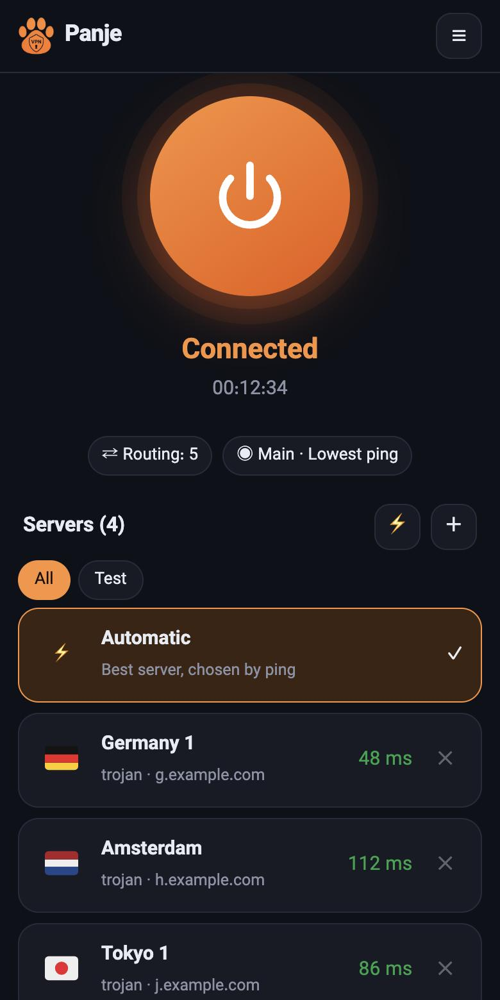
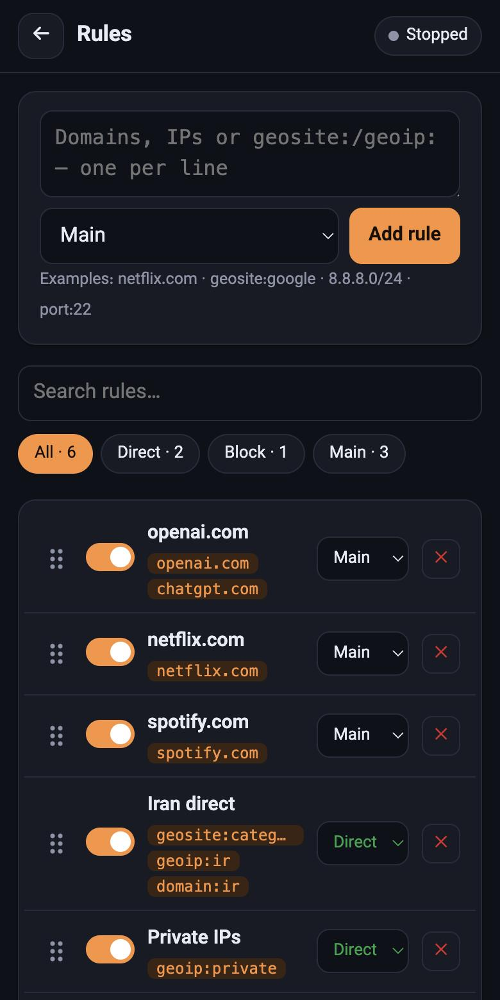
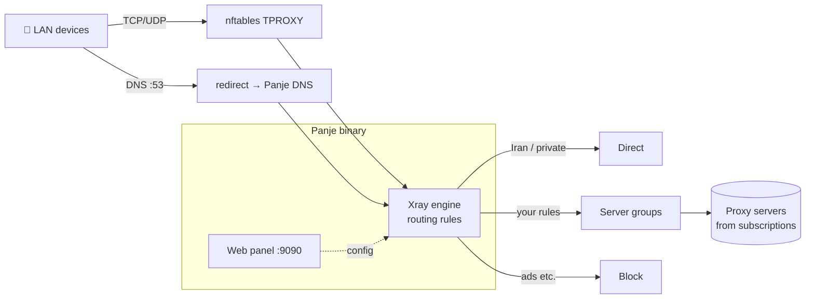

<div align="center">


# Panje · پنجه

**A simple, fast Xray (V2Ray) client for OpenWrt — Passwall, but small.**
One static binary · built-in Xray engine · mobile-friendly web panel · smart routing rules.

[](https://github.com/NimaParsayi/PanjeOpenWRT/releases)
[](https://github.com/NimaParsayi/PanjeOpenWRT/actions)
[](LICENSE)

**English** · [فارسی](README.fa.md)

 &nbsp; 

</div>

> **Status: early release.** Core features work, but Panje is young and has seen limited real-world testing.
> Please [open an issue](https://github.com/NimaParsayi/PanjeOpenWRT/issues) if something misbehaves on your router.

## Why Panje?

| | |
|---|---|
| 🧩 **One file** | A single ~30 MB static binary. The **Xray-core engine is built in** — no `xray` package to install. |
| 🇮🇷 **Iran-aware routing** | Iranian domains and IPs go **direct** out of the box; everything else goes through your proxy. |
| 🎯 **Rules in seconds** | Paste domains/IPs, pick *Direct*, *Block* or a server group. Applied instantly. Drag to reorder, filter, search. |
| ⚖️ **Groups & balancing** | Lowest ping, round-robin, random or one fixed server — per rule. |
| 🔗 **Subscriptions** | `vmess://` `vless://` (Reality) `trojan://` `ss://`, base64 or plain, auto-updated. |
| 🌍 **Geo files** | Download the Iran lists with one tap, or upload your own `.dat` files. |
| 📱 **Phone-first UI** | Installable web app (PWA), dark/light, English & Persian (RTL), flags for server names. |
| 🔐 **Remote access** | Password-protected panel on port `9090`, rate-limited login. |

## How it works



Panje writes an Xray config from your rules, runs the engine, and installs a small `nftables` table that transparently redirects LAN traffic (and DNS) into it. Stop it and the table disappears.

## Install (one command)

Run this **on your router** (SSH in as `root`). It detects your CPU, installs the dependencies, downloads the right binary from the latest release, sets up autostart and prints your panel URL and password.

```sh
wget -qO- https://raw.githubusercontent.com/NimaParsayi/PanjeOpenWRT/main/scripts/get.sh | sh
```

<details>
<summary><b>GitHub is blocked / slow on the router? Install from your computer instead</b></summary>

1. Download the binary matching your router from the [Releases page](https://github.com/NimaParsayi/PanjeOpenWRT/releases) on any device that can reach GitHub.
2. Copy the binary **and** the installer to the router, then run the installer with `PANJE_BIN`:

```sh
scp -O panje-arm64 scripts/get.sh root@192.168.1.1:/tmp/      # pick your architecture, see table below
ssh root@192.168.1.1
  PANJE_BIN=/tmp/panje-arm64 sh /tmp/get.sh
```
(The router still needs access to the OpenWrt package repositories to install `nftables` & co.)
</details>

<details>
<summary><b>Which binary is mine? (architecture table)</b></summary>

Run `. /etc/openwrt_release; echo $DISTRIB_ARCH` on the router:

| `DISTRIB_ARCH` starts with | Download | Typical devices |
|---|---|---|
| `aarch64_` | `panje-arm64` | Raspberry Pi 4/5, Filogic (MT7981/86), newer Xiaomi/GL.iNet |
| `arm_cortex-a` | `panje-armv7` | Google WiFi, Linksys WRT, IPQ40xx/IPQ806x |
| `x86_64` | `panje-amd64` | x86 mini PCs, VMs |
| `mipsel_` | `panje-mipsle` | MT7621 (Xiaomi 4A Gigabit, many others) |
| `mips_` | `panje-mips` | Atheros / QCA (TP-Link Archer…) |

Older 32-bit ARM (ARMv5/v6) is not supported. The installer picks the right one automatically.
</details>

<details>
<summary><b>Manual install (no script)</b></summary>

```sh
# on your computer: build or download panje-<arch>, then
scp -O panje-arm64 root@192.168.1.1:/usr/bin/panje
scp -O files/etc/init.d/panje root@192.168.1.1:/etc/init.d/panje
ssh root@192.168.1.1

# on the router
chmod +x /usr/bin/panje /etc/init.d/panje
apk add nftables kmod-nft-tproxy ip-full ca-bundle      # OpenWrt ≤ 24: use  opkg update && opkg install ...
panje -c /etc/panje/config.json passwd 'choose-a-password'
/etc/init.d/panje enable && /etc/init.d/panje start
```
</details>

**Requirements:** OpenWrt with nftables/fw4 (22.03 or newer), roughly 35 MB of free flash for the binary and some spare RAM (the engine is embedded, so expect tens of MB while running).

## First steps (2 minutes)

1. Open **`http://<router-ip>:9090`** and sign in with the printed password.
2. Tap **＋** → paste your **subscription URL** (or server links).
3. Tap **Menu ☰ → Settings → Update geo data** (needed once; or upload your own `geoip.dat` / `geosite.dat`).
4. Back on the home screen tap the big **power button**. 🎉

Iranian sites already go direct. To change what goes where, open **Menu → Rules**.

## Writing rules

Type or paste **one entry per line** in the box at the top of *Rules*, choose where it should go, press **Add rule**.

| You type | Matches |
|---|---|
| `example.com` | `example.com` **and all its subdomains** |
| `full:www.example.com` | exactly that host only |
| `keyword:google` | any domain containing the word |
| `regexp:^ads?\..+` | a regular expression |
| `geosite:netflix` | a whole category from `geosite.dat` |
| `geosite:category-ir` | all Iranian sites |
| `8.8.8.0/24`, `1.1.1.1` | an IP range / address |
| `geoip:ir`, `geoip:private` | a country / private networks |
| `port:22,443` | destination ports |
| `ext:mylist.dat:work` | a tag from your own uploaded `.dat` |

**Targets:** `Direct` (bypass the proxy), `Block`, or any **group** you created.
Rules are checked **top to bottom — first match wins**; whatever matches nothing follows *Everything else* at the bottom. Drag the ⋮⋮ handle to reorder, use the chips to filter by target, search to find a rule.

<details>
<summary><b>Recipe: whitelist a domain and all its subdomains</b></summary>

*Rules* → type `example.com` → target **Direct** → **Add rule**. New rules land on top, so they win over the defaults.
</details>

<details>
<summary><b>Recipe: send only some sites through one specific server</b></summary>

1. *Menu → Groups → New group* → name it `Streaming`, strategy **Single**, tick the one server.
2. *Rules* → paste `netflix.com`, `geosite:netflix` → target **Streaming**.
3. Everything else keeps using *Main* (e.g. round-robin or lowest ping).
</details>

<details>
<summary><b>Recipe: block ads</b></summary>

Enable the pre-made **Block ads** rule (`geosite:category-ads-all`) in *Rules*.
</details>

## Groups

| Strategy | Behaviour |
|---|---|
| **Lowest ping** | Xray probes servers every minute and uses the fastest |
| **Round robin** | rotates through the servers per connection |
| **Random** | picks a random server per connection |
| **Single** | always the first server of the group |

A group can contain individual servers and/or **entire subscriptions** (new servers from an update join automatically). On the home screen, tapping a server sets *Main* to that one server; **Automatic** goes back to lowest-ping over everything.

## Phone app (PWA)

*iPhone:* Safari → Share → **Add to Home Screen**. *Android:* Chrome menu → **Install app / Add to Home screen**.
Browsers enable the offline service worker only on **HTTPS** (or localhost). Over plain `http://` you still get the icon and full-screen mode. For a full PWA, publish the panel over HTTPS (reverse proxy / Tailscale Serve).

## Security

- The panel is plain HTTP. On a trusted LAN that is fine; for internet access put it behind a VPN or an HTTPS reverse proxy, and do **not** expose port 9090 on the WAN otherwise.
- Change the password any time: `panje -c /etc/panje/config.json passwd 'new-password'` or *Menu → Settings*.
- Config lives in `/etc/panje/config.json` (mode 600). Passwords are stored as salted PBKDF2 hashes.

## Troubleshooting

<details>
<summary><b>Blocked sites (YouTube…) don't open but Iranian sites do</b></summary>

Check DNS from a LAN device: `nslookup youtube.com`. An answer like `10.10.34.x` means the ISP's poisoned DNS is leaking. Panje redirects LAN port-53 traffic to its own DNS to prevent this — make sure the panel shows *Connected* with **Transparent proxy for LAN** enabled (Settings), the device isn't using hard-coded DNS/"Secure DNS" in the browser, and clear the device's DNS cache.
</details>

<details>
<summary><b>Start fails: <code>geosite.dat: no such file</code></b></summary>

Do *Menu → Settings → Update geo data* (or upload the `.dat` files). If GitHub is unreachable from the router, download `geoip.dat` and `geosite.dat` from [Iran-v2ray-rules](https://github.com/Chocolate4U/Iran-v2ray-rules/releases/latest) and upload them in the same screen.
</details>

<details>
<summary><b>I lost the password</b></summary>

`ssh root@router` then `panje -c /etc/panje/config.json passwd 'new-password'` and `/etc/init.d/panje restart`.
</details>

<details>
<summary><b>Nothing is proxied / nft errors</b></summary>

Install the packages: `apk add nftables kmod-nft-tproxy ip-full` (or `opkg install …`), set **LAN interface** in Settings to your bridge (usually `br-lan`), then Stop/Start. Inspect with `nft list table inet panje` and *Menu → Logs*.
</details>

<details>
<summary><b>Limitations</b></summary>

IPv4 transparent proxy only · traffic generated by the router itself is not proxied · SS plugins (obfs/v2ray-plugin) unsupported · SOCKS `:1080` and HTTP `:1081` are available for apps that prefer them.
</details>

## Build from source

Needs Go ≥ 1.26 (see `go.mod`).

```sh
git clone https://github.com/NimaParsayi/PanjeOpenWRT && cd PanjeOpenWRT
go test ./...
./build.sh            # all targets → dist/panje-{amd64,arm64,armv7,mipsle,mips}
./build.sh arm64      # just one
```
Tip: `upx --best dist/panje-arm64` shrinks the binary to ~9 MB on flash-constrained routers (untested).
Releases are built by GitHub Actions when a `v*` tag is pushed.

## Contributing

Issues and PRs welcome. Layout: `store.go` (data) · `links.go` (share-link parsing) · `xraycfg.go` (rules → Xray config) · `core.go` (process, nftables, downloads) · `server.go` (API) · `web/` (the whole UI, no build step).

## Credits & license

[MIT](LICENSE). Built on [Xray-core](https://github.com/XTLS/Xray-core) (MPL-2.0). Font [Vazirmatn](https://github.com/rastikerdar/vazirmatn) (OFL), flag glyphs from Twemoji. Default geo data by [Chocolate4U](https://github.com/Chocolate4U/Iran-v2ray-rules). See [NOTICE.md](NOTICE.md).
